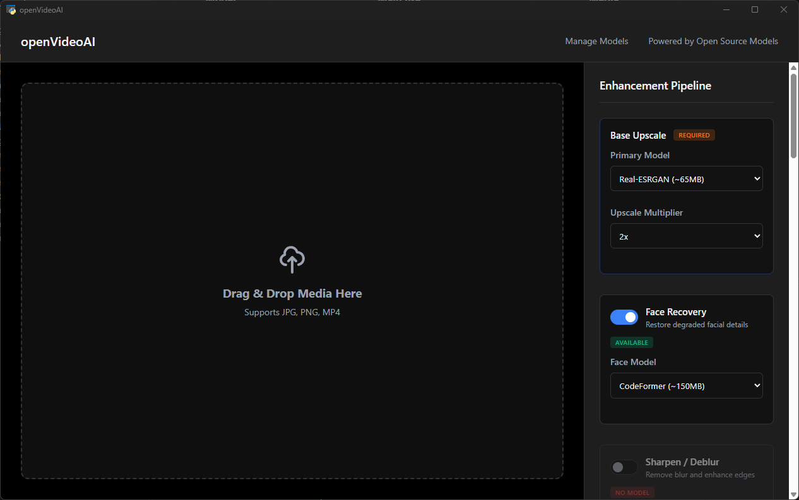
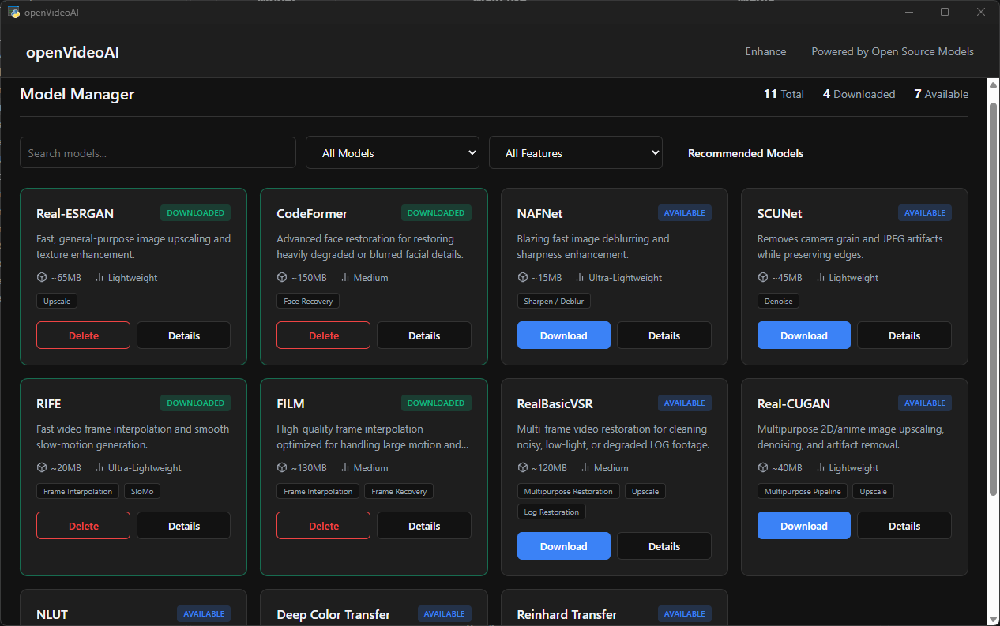

# openVideoAI

<p align="center">
  
</p>

Local-first toolkit for managing open-source image and video enhancement models.

---

> **Status:** Early development. Model discovery, downloads, and UI configuration
> are available; media processing and export are not fully implemented yet.

## Overview

openVideoAI provides model discovery and downloads, a FastAPI backend, and a
browser UI for configuring image and video enhancement workflows. It is in
early development: the catalog and UI settings are available, but end-to-end
media inference and export are not implemented yet.

## Screenshots
| Enhancment Page| Models Manager | 
| --- | --- |
|  |  |


## Features

- Browse enhancement models and manage local downloads.
- Configure enhancement options in the browser UI.
- Explore model metadata and available feature categories through the API.
- Run locally without a cloud dependency.

## GPU acceleration

- **NVIDIA CUDA** — detected automatically; use the *CUDA (NVIDIA)* backend.
- **AMD (Windows)** — install `torch-directml` to enable DirectML
  acceleration on AMD/Intel cards:

  ```bash
  pip install -r requirements-amd.txt
  ```

  Restart the app afterwards. The Settings page will enable the
  *AMD GPU (DirectML)* backend and list your adapter. Invalid/legacy device
  settings never reach PyTorch — an unusable device string falls back to the
  best available accelerator automatically.
- **AMD (Linux)** — a ROCm build of PyTorch is detected automatically
  (`hip` backend).
- **Apple Silicon** — Metal/MPS acceleration is enabled on Apple Silicon.

### Performance

- **Auto-tuned tiling.** Real-ESRGAN processes large frames in tiles; each
  tile is a separate GPU dispatch with fixed overhead (especially on
  DirectML). When the tile size is left at the shipped default (400 px) the
  app auto-upgrades it based on your GPU's VRAM (512 / 768 / 1024 px on
  4 / 8 / 12+ GB cards), which can cut tiling overhead several-fold. Pick an
  explicit tile size in Settings to override it.
- **Model choice matters.** For video, the light 6-block
  `RealESRGAN_x4plus_anime_6B` model runs roughly 3–4× faster than the full
  23-block `RealESRGAN` with a modest quality trade-off, and `RealESRGAN_x2plus`
  halves the output size when 2× is enough.
- **Half precision** (Settings → Enable FP16) roughly doubles speed on
  capable GPUs when the backend supports it.

## Model ecosystem

The catalog includes image and video restoration models for upscaling, face
recovery, denoising, sharpening, and frame interpolation, alongside color
transfer models such as NLUT, Deep Color Transfer, and Reinhard Transfer. It
also includes pure-math (non-AI) optical-flow algorithms for frame
interpolation (Farnebäck, DIS, Dual TV-L1, Lucas-Kanade, EpicFlow) that run
directly on CPU with no model download.

Each entry declares its compute requirements (`isAi`, `requiresCuda`,
`requiresMetal`, `canRunOnCpu`) in `models.json`. CUDA-required models can only
be downloaded on machines with a CUDA-capable GPU, and Metal-required models
only on Apple Silicon devices.

See [models.md](models.md) for the complete catalog, comparisons, and usage
notes. Catalog entries describe intended integrations; they do not imply that
inference is implemented.

## Progress

| Area | Status |
|------|--------|
| Model catalog and model management | Available |
| Web UI and API | In progress |
| Enhancement settings | Available (persisted system, GPU, export, and appearance preferences) |
| Media inference and export | In progress (upscaling is available; full multi-feature export is planned) |
| CLI, batch processing, and presets | Planned |

For details, see [Project status](docs/PROJECT_STATUS.md).
